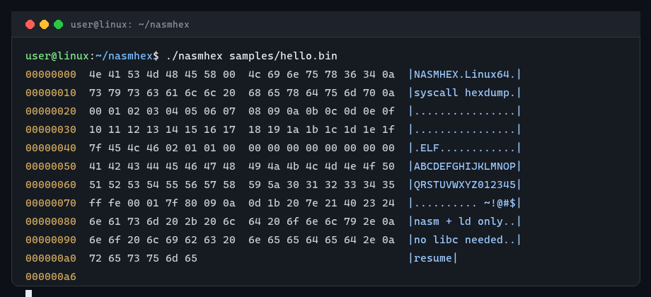

# nasmhex

x86-64 Linux hexdump. NASM, syscalls, no libc.



## interface

One file in, `hexdump -C` lines out. No stdin, no libc, no flags.

```
00000000  4e 41 53 4d 48 45 58 00  4c 69 6e 75 78 36 34 0a  |NASMHEX.Linux64.|
^^^^^^^^  ^^^^^^^^ hex, space after byte 8 ^^^^^^^^^^^^^^^^  ^^^^^^^^ascii^^^^^
offset
```

| column | width | what it is |
|---|---|---|
| **offset** | 8 hex digits | byte index of the row |
| **hex** | 16 bytes | `xx` plus a gap after the 8th byte; short last row is space-padded |
| **ascii** | `|…|` | `0x20–0x7e` as-is, everything else `.` |

Last line is the file size as an offset, same as GNU `hexdump -C`.

```
./nasmhex samples/hello.bin
```

Missing operand → usage on stderr, exit 1. EACCES / EISDIR / open / read / write failures → message on stderr, exit 1.

## session

```
user@linux:~/nasmhex$ ./nasmhex samples/hello.bin
00000000  4e 41 53 4d 48 45 58 00  4c 69 6e 75 78 36 34 0a  |NASMHEX.Linux64.|
00000010  73 79 73 63 61 6c 6c 20  68 65 78 64 75 6d 70 0a  |syscall hexdump.|
00000020  00 01 02 03 04 05 06 07  08 09 0a 0b 0c 0d 0e 0f  |................|
00000030  10 11 12 13 14 15 16 17  18 19 1a 1b 1c 1d 1e 1f  |................|
00000040  7f 45 4c 46 02 01 01 00  00 00 00 00 00 00 00 00  |.ELF............|
00000050  41 42 43 44 45 46 47 48  49 4a 4b 4c 4d 4e 4f 50  |ABCDEFGHIJKLMNOP|
00000060  51 52 53 54 55 56 57 58  59 5a 30 31 32 33 34 35  |QRSTUVWXYZ012345|
00000070  ff fe 00 01 7f 80 09 0a  0d 1b 20 7e 21 40 23 24  |.......... ~!@#$|
00000080  6e 61 73 6d 20 2b 20 6c  64 20 6f 6e 6c 79 2e 0a  |nasm + ld only..|
00000090  6e 6f 20 6c 69 62 63 20  6e 65 65 64 65 64 2e 0a  |no libc needed..|
000000a0  72 65 73 75 6d 65                                 |resume|
000000a6
```

`samples/hello.bin` is 166 bytes. `tests/golden.txt` is that dump frozen.

## build

```
docker build -t nasmhex . && docker run --rm nasmhex
```

or on Linux:

```
make
./nasmhex samples/hello.bin
```

`scripts/host_dump.sh` is the same dump without Docker. `python3 tests/test_dump.py` checks the golden (and Docker / a host binary when they exist).
